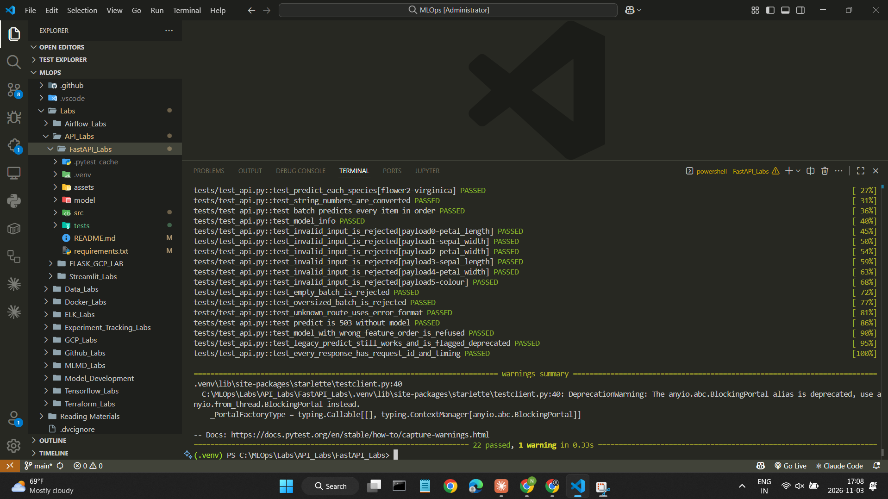
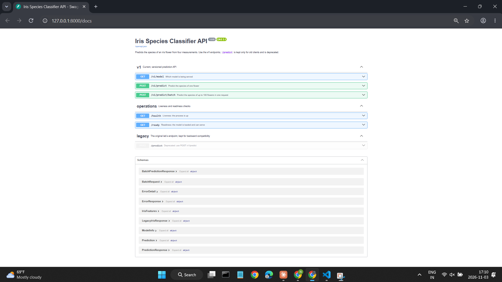
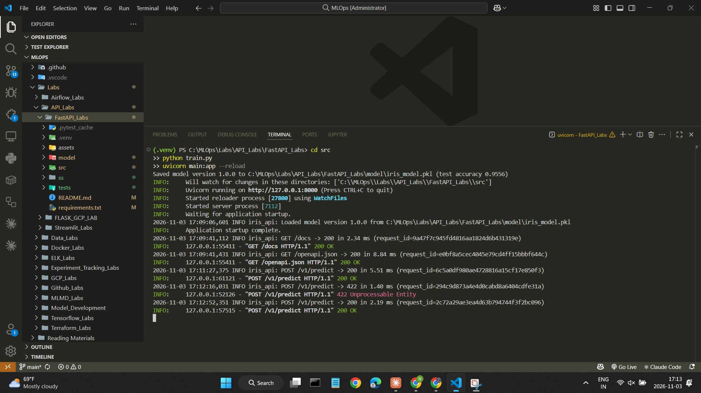

# API Lab (Modified): Serving an ML Model with FastAPI

A modification of the course's FastAPI lab. The model is unchanged (the same decision tree on the Iris dataset). **All my changes are to the lab's core concept, serving a model as an API**: how the model is loaded, how inputs are validated, what the API returns, how it reports health and errors, how it's versioned, and how it's tested.

**In short:** 11 changes to the API (below), each covered by an automated test, with **22 of 22 tests passing**.

**Contents:** [1. What I changed](#1-what-i-changed) · [2. Evidence from my run](#2-evidence-from-my-run) · [3. How to run it](#3-how-to-run-it)

---

## 1. What I changed

### Summary: every change, the problem it fixes, and the test that proves it

| # | What I changed | Problem in the original | Verified by (in `tests/test_api.py`) |
|---|---|---|---|
| 1 | **Model loaded once at startup** with FastAPI's `lifespan` hook, from a path that works from any folder | `joblib.load` ran **inside every request**, from a relative path (`../model/`) that only worked when started from `src/` | `test_ready_reports_loaded_model` |
| 2 | **Strict input validation:** every measurement must be positive and realistic, and unknown fields are rejected | Negative or absurd values (e.g. `petal_length: -50`) got a prediction; extra fields were silently ignored | `test_invalid_input_is_rejected` (6 cases: negative, zero, too large, not a number, missing, unknown field) |
| 3 | **Richer response:** species name, per-class probabilities, and the model version | Returned a bare number: `{"response": 0}` | `test_predict_each_species` (all 3 species) |
| 4 | **Batch endpoint** `POST /v1/predict/batch` for 1–100 flowers, with the limits enforced | One flower per request only | `test_batch_predicts_every_item_in_order`, `test_empty_batch_is_rejected`, `test_oversized_batch_is_rejected` |
| 5 | **Versioned API** (`/v1/...`); the old `POST /predict` keeps its exact contract but is **marked deprecated** in the docs and response headers | No versioning, so any change would break clients | `test_legacy_predict_still_works_and_is_flagged_deprecated` |
| 6 | **Liveness vs. readiness:** `/health` (process is up) and `/ready` (model loaded), plus `GET /v1/model` reporting which model is served | `/` always said "healthy", even with no model; no way to know which model was live | `test_health_is_always_ok`, `test_ready_is_503_without_model`, `test_model_info` |
| 7 | **Model bundle with metadata,** checked at startup: `train.py` saves the model with its version, test accuracy, feature order and class names; the API refuses a model whose feature order doesn't match its input contract | The model file carried no metadata, so the API couldn't verify or describe it | `test_model_with_wrong_feature_order_is_refused` |
| 8 | **One error format** for 422, 404, 503 and 500, with a request id; internal errors are logged server-side, never sent to clients | A catch-all turned every failure into a 500 that **echoed the internal error message** to the client | `test_invalid_input_is_rejected`, `test_unknown_route_uses_error_format`, `test_predict_is_503_without_model` |
| 9 | **`def` instead of `async def`** for prediction endpoints, so FastAPI runs the CPU-bound model call in its thread pool | `async def` wrapped a blocking scikit-learn call, which **blocks the event loop**, so concurrent requests queue up | (design change, explained below) |
| 10 | **Request middleware:** `X-Request-ID` (echoed or generated) and `X-Process-Time-ms` on every response, plus one log line per request | No request tracing or timing | `test_every_response_has_request_id_and_timing` |
| 11 | **Automated test suite:** 22 pytest tests using FastAPI's `TestClient`, which train their own model, so they never depend on a committed file | No tests | `pytest -v` |

### Details

**Startup loading and readiness (1, 6).** The model is loaded once in the `lifespan` hook and passed to endpoints through a dependency (`get_model`). If the model file is missing, in the old format, or inconsistent, the API **still starts**, but:
- **`/health` returns 200,** because the process is alive,
- **`/ready` returns 503 with the reason,** and
- **the prediction endpoints return 503.**

This is how an orchestrator such as Kubernetes tells "restart it" apart from "don't send it traffic yet".

**Validation (2).** The Pydantic schema (`src/schemas.py`) bounds each measurement (`0 < sepal/petal length and sepal width ≤ 10`, `0 < petal width ≤ 5`) and sets `extra="forbid"`. Numbers sent as strings (`"5.1"`) are still accepted and converted, as before. Field descriptions and example payloads appear in `/docs`.

**Response (3, 4).** Single prediction:
```json
{"class_id": 0, "species": "setosa",
 "probabilities": {"setosa": 1.0, "versicolor": 0.0, "virginica": 0.0},
 "model_version": "1.0.0"}
```
The batch endpoint returns `model_version`, `count`, and one prediction per flower, in the order sent.

**Versioning and deprecation (5).** All current endpoints live under `/v1`. The original `POST /predict` still accepts the same body and returns the same `{"response": <int>}`, so existing clients keep working. It's marked `deprecated` in the OpenAPI docs, and every response carries `Deprecation: true` and a `Link` header pointing to `/v1/predict`.

**Model bundle (7).** `train.py` saves `{"estimator": model, "metadata": {...}}` in one file, written atomically:
- **`model_version`,** and the time it was trained,
- **the test accuracy,**
- **the feature order and class names,** and
- **the hyperparameters.**

The model and the facts the API reports about it can't drift apart. At startup, the API checks the model's feature order against its own input schema and refuses a mismatched model. Otherwise, features sent in the wrong order would produce silently wrong predictions.

**Errors (8).** Every error has this shape:
```json
{"error": {"code": "validation_error", "message": "Request body is invalid",
           "details": [{"field": "body.petal_length", "message": "Input should be greater than 0", "type": "greater_than"}]},
 "request_id": "3f9c..."}
```
Unexpected exceptions are logged with their traceback, tagged with the request id, and returned to the client as a generic 500.

**`def` vs. `async def` (9).** In FastAPI, an `async def` endpoint runs directly on the event loop. A blocking call inside it, such as `model.predict`, stalls **every** other request until it finishes. A plain `def` endpoint is run in a worker thread instead, keeping the server responsive. The original used `async def` with a blocking model call.

### Supporting changes (not the focus)

- **Fixed the README's run command:** it said `uvicorn app:main`, but the correct command is `uvicorn main:app`.
- **Pinned, compatible versions** in `requirements.txt`, replacing `fastapi[all]`.
- **Unchanged on purpose:** the Iris data, the train/test split (`random_state=12`), and the decision tree (`max_depth=3`).

---

## 2. Evidence from my run

### All 22 tests pass (change 11)

`pytest -v` runs every test in `tests/test_api.py`, covering changes 1–8 and 10:



The single warning comes from inside the Starlette test client library, not from this code.

### Versioned, documented API with a deprecated legacy route (changes 2, 5, 6)

The interactive docs at `/docs` group the endpoints into **v1**, **operations** (`/health`, `/ready`) and **legacy**. The original `POST /predict` is struck through as deprecated, pointing to `POST /v1/predict`. The schemas include the request contracts and the shared `ErrorResponse`:



### Richer response with request tracing (changes 3, 10)

`POST /v1/predict` returns the species, per-class probabilities and model version. The response headers carry `x-request-id` and `x-process-time-ms` (2.19 ms here):


### Validation in one error format (changes 2, 8)

Sending `petal_width: -1` returns **422** in the shared error format. It names the field and the rule, and its `request_id` matches the response header:


### Model loaded once at startup, one log line per request (changes 1, 7, 10)

`train.py` saved model version 1.0.0 (test accuracy 0.9556). Uvicorn loaded it **once, at startup**, and then logged every request with its status, time and request id. The ids match the two screenshots above (`2c72a29a...` for the 200, `294c9d87...` for the 422), so any response can be traced to its log line:



---

## 3. How to run it

### Prerequisites

| Tool | Version | Notes |
|---|---|---|
| Python | **3.10–3.12** | Check with `python --version` |
| Disk space | about 300 MB | |

Pinned in [`requirements.txt`](requirements.txt): fastapi 0.115.5, uvicorn 0.32.1, pydantic 2.9.2, scikit-learn 1.5.2, joblib 1.4.2, numpy 1.26.4, pytest 8.3.3, httpx 0.27.2.

### Setup

From this folder (`Labs/API_Labs/FastAPI_Labs`):

**Windows (PowerShell):**
```powershell
python -m venv .venv
.venv\Scripts\Activate.ps1
pip install -r requirements.txt
```

**macOS / Linux:**
```bash
python3 -m venv .venv
source .venv/bin/activate
pip install -r requirements.txt
```

### 1. Train the model

```bash
cd src
python train.py
```

This prints `Saved model version 1.0.0 to ... (test accuracy 0.9556)`. Re-run it with `--version 1.1.0` to label a new version.

### 2. Start the API

Still in `src/`:

```bash
uvicorn main:app --reload
```

The log shows `Loaded model version 1.0.0`. Open **http://127.0.0.1:8000/docs** for the interactive documentation, with the `v1`, `operations` and `legacy` sections.

### 3. Call it

In the docs page, open an endpoint, click **Try it out**, then **Execute**. The example body is pre-filled. Or from a second terminal (PowerShell):

```powershell
Invoke-RestMethod http://127.0.0.1:8000/ready
Invoke-RestMethod -Method Post -Uri http://127.0.0.1:8000/v1/predict -ContentType "application/json" `
  -Body '{"sepal_length": 6.4, "sepal_width": 3.2, "petal_length": 4.5, "petal_width": 1.5}'
```

macOS / Linux:
```bash
curl http://127.0.0.1:8000/ready
curl -X POST http://127.0.0.1:8000/v1/predict -H "Content-Type: application/json" \
  -d '{"sepal_length": 6.4, "sepal_width": 3.2, "petal_length": 4.5, "petal_width": 1.5}'
```

### 4. Run the tests

From this folder (`FastAPI_Labs`, not `src`), with the venv activated:

```bash
pytest -v
```

The tests train their own temporary model, so they don't need step 1 and don't touch `model/`.

### What a successful run looks like

- **`train.py`** prints the saved version and a test accuracy of 0.9556.
- **The API log** shows `Loaded model version 1.0.0`, then one line per request with its status, time and request id.
- **`/docs`** lists `GET /v1/model`, `POST /v1/predict`, `POST /v1/predict/batch`, `GET /health`, `GET /ready`, and the struck-through (deprecated) `POST /predict`.
- **`POST /v1/predict`** with the example body returns `"species": "setosa"`, its probabilities, and `"model_version": "1.0.0"`.
- **`pytest -v`** ends with **`22 passed`**.

### Troubleshooting

- **`/ready` returns 503 with "model file is in the old format":** the `model/iris_model.pkl` from the original lab is a bare model without metadata. Run `python train.py` in `src/`.
- **`/ready` returns 503 with "model file not found":** run `python train.py` in `src/` first.
- **`ModuleNotFoundError: No module named 'predict'`** when starting uvicorn: start it from inside `src/`.
- **`ModuleNotFoundError` when running pytest:** run `pytest` from the `FastAPI_Labs` folder, with the venv activated.
- **Port 8000 is in use:** start the server with `uvicorn main:app --reload --port 8001`.

### Files

```
FastAPI_Labs/
├── src/
│   ├── data.py          # load and split the Iris data (unchanged)
│   ├── train.py         # train and save the model bundle with metadata
│   ├── predict.py       # load and validate the bundle; predict with probabilities
│   ├── schemas.py       # request/response contracts (Pydantic)
│   └── main.py          # the FastAPI app
├── tests/
│   ├── conftest.py      # trains a temporary model; TestClient fixtures
│   └── test_api.py      # 22 API tests
├── model/
│   └── iris_model.pkl   # written by train.py
├── assets/              # the original lab's screenshots
├── ss/                  # screenshots from my run
├── requirements.txt
└── README.md
```
