# Airflow Lab 1 (Modified): Asset-Driven K-Means Pipeline with a Data-Quality Gate

This lab orchestrates a customer-segmentation pipeline (K-Means clustering on credit-card customers) with **Apache Airflow 3.1**. It is a modification of the course's Airflow Lab 1. The changes are to the **orchestration itself**: how the DAGs are scheduled, how tasks branch, run in parallel, retry, and pass data. See [What I changed](#what-i-changed).

It has two DAGs:

1. **`credit_card_data_ingestion`** runs on a cron schedule. It lands the raw data and publishes it as an Airflow **Asset**.
2. **`kmeans_customer_segmentation`** is **scheduled on that Asset**, so it starts automatically when new data lands. It validates the data, **branches** on the result, trains one K-Means model per k **in parallel with dynamic task mapping**, picks the elbow, and evaluates and reports.

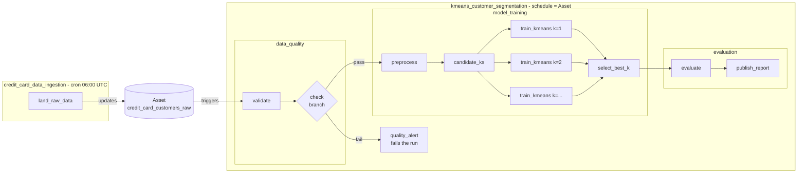

---

## 1. Prerequisites

You only need Docker. Airflow, Python, and every library run inside containers.

| Tool | Version | Notes |
|---|---|---|
| Docker Desktop (Windows/macOS) or Docker Engine (Linux) | Docker Desktop 4.x / Engine 23+ | On Windows, use the default **WSL 2** backend. |
| Docker Compose | v2.20+ | Included with Docker Desktop. Check with `docker compose version`. |
| Memory for Docker | **at least 4 GB**, 8 GB recommended | Docker Desktop → Settings → Resources. |
| Git | any | To clone the repo. |

Versions used inside the containers (pinned in `Dockerfile` and `requirements.txt`):

| Component | Version |
|---|---|
| Apache Airflow | 3.1.5 (official `apache/airflow` image, Python 3.12) |
| PostgreSQL (Airflow metadata DB) | 16 |
| scikit-learn / kneed / matplotlib / pytest | 1.5.2 / 0.8.5 / 3.9.2 / 8.3.3 |

## 2. Setup

Start Docker Desktop and wait until it shows "Engine running". Then, in a terminal (PowerShell on Windows):

```bash
git clone <this-repo-url>
cd <repo>/Labs/Airflow_Labs/Lab_1
```

**Linux only:** set your user id so the files Airflow writes belong to you:

```bash
sed -i "s/^AIRFLOW_UID=.*/AIRFLOW_UID=$(id -u)/" .env
```

On Windows and macOS, leave `.env` as it is.

Build the image and initialize Airflow. This is a one-time step that migrates the database and creates the admin user:

```bash
docker compose build
docker compose up airflow-init
```

`airflow-init` should end with `exited with code 0`. On Linux/macOS, `./setup.sh` does all of the above in one step.

## 3. Run

```bash
docker compose up -d
docker compose ps
```

Wait about a minute until `airflow-apiserver`, `airflow-scheduler`, `airflow-dag-processor` and `airflow-triggerer` all show **`(healthy)`**. Then open **http://localhost:8080** and log in with **`airflow` / `airflow`** (set in `.env`).

You will see two DAGs. New DAGs start paused, so **unpause both** with the toggle on the left.

### Demo 1: the normal path (Asset-triggered training)

1. Open **`credit_card_data_ingestion`**, click **Trigger** (▶), and keep `inject_bad_data` unchecked.
2. When `land_raw_data` succeeds, Airflow records an Asset event. **`kmeans_customer_segmentation` starts by itself.** Its run type shows as *asset triggered*, and nobody clicked it.
3. Open that run's **Graph** view. `data_quality.check` picks the training path and `quality_alert` is skipped (pink). `model_training.train_kmeans` expands into **20 mapped task instances** (k = 1…20), up to 8 running at once.
4. All tasks end green. Outputs land on your machine in `working_data/latest/`:
   - `run_summary.json`: best k, the SSE for every k, silhouette score, cluster sizes, and the cluster predicted for `test.csv`
   - `elbow_plot.png`: the SSE curve with the chosen k marked

### Demo 2: the data-quality gate stops a bad run

1. Trigger **`credit_card_data_ingestion`** again, this time with **`inject_bad_data` checked**. It lands data with 20% of `CREDIT_LIMIT` missing and 50 negative `PURCHASES` values.
2. The training DAG starts automatically. `data_quality.check` branches to **`quality_alert`**. All training and evaluation tasks are **skipped**, and the run ends **failed** with the reasons in the `quality_alert` log, for example:
   ```
   Data-quality gate failed, training skipped: CREDIT_LIMIT: 20.0% nulls exceeds limit of 5.0%; PURCHASES: 50 negative values (expected >= 0)
   ```
   The report is also saved as `working_data/runs/<run_id>/quality_failure.json`.
3. Trigger ingestion once more without the checkbox to land clean data again.

### Demo 3: retries with exponential backoff

1. Trigger **`kmeans_customer_segmentation`** manually and check **`simulate_failure`** in the form.
2. In the Graph view, open the mapped instance for **k = 2** of `train_kmeans`. Its first attempt fails with `Simulated transient failure`, the retry callback logs `RETRYING ...`, and the second attempt succeeds. Every other k runs normally, and the run still ends green.

### Demo 4: runtime parameters

Trigger **`kmeans_customer_segmentation`** manually and change the form values, for example `k_max = 10` or different `features` such as `["BALANCE", "PAYMENTS"]`. The number of mapped `train_kmeans` tasks changes to match the k range at runtime, with no code change. An invalid range (`k_min` ≥ `k_max`) fails `candidate_ks` immediately, without retries, because retrying a configuration error is pointless.

### Run the tests

With the stack running:

```bash
docker compose exec airflow-scheduler python -m pytest -q -p no:cacheprovider /opt/airflow/tests
```

Expected: **10 passed**. This covers unit tests for the pipeline logic plus DAG-integrity tests, which check that the DAGs import cleanly, have the expected task structure, branch to exactly two paths, and that the training DAG retries but the alert task doesn't.

### Stop

```bash
docker compose down        # stop containers, keep the Airflow database
docker compose down -v     # also wipe the database (DAG run history)
```

## 4. What a successful run looks like

Everything below is from an actual run of this lab.

### Results at a glance

| | |
|---|---|
| Elbow (chosen k) | **k = 5** (found by `kneed`), from 20 models trained in parallel (k = 1–20) |
| Silhouette score | **0.466** |
| Rows used | **8,949 of 8,950** (only rows missing one of the 3 features are dropped; the original dropped rows missing *any* of 18 columns) |
| Cluster sizes | 5,273 / 1,734 / 1,187 / 398 / 357 |
| `test.csv` customer | assigned to cluster 0 (input scaled with the saved scaler) |
| Quality gate | blocked the corrupted data: `CREDIT_LIMIT` 20.0% nulls, 50 negative `PURCHASES` |
| Retry | k = 2 failed on attempt 1 and succeeded on attempt 2; the run stayed green |
| Tests | **10 passed** in 4.6 s |

### Setup and health

`docker compose up airflow-init` exits with code 0 after creating the admin user, and `docker compose up -d` starts all services:


The Health panel on the home page shows MetaDatabase, Scheduler, Triggerer and Dag Processor all green:

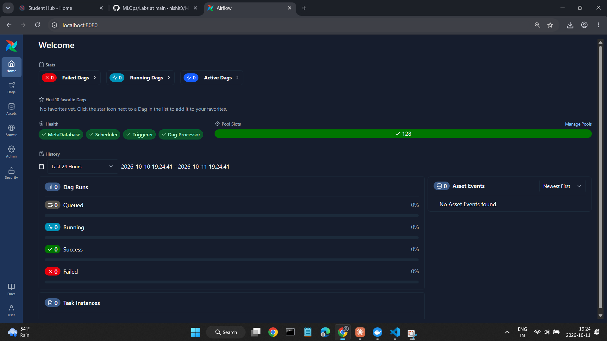

### Demo 1: Asset-triggered training

Ingestion lands the data and creates an **Asset event** carrying `rows: 8950` and `bad_data_injected: false`. Under **Triggered Dag Run**, `kmeans_customer_segmentation` started automatically:

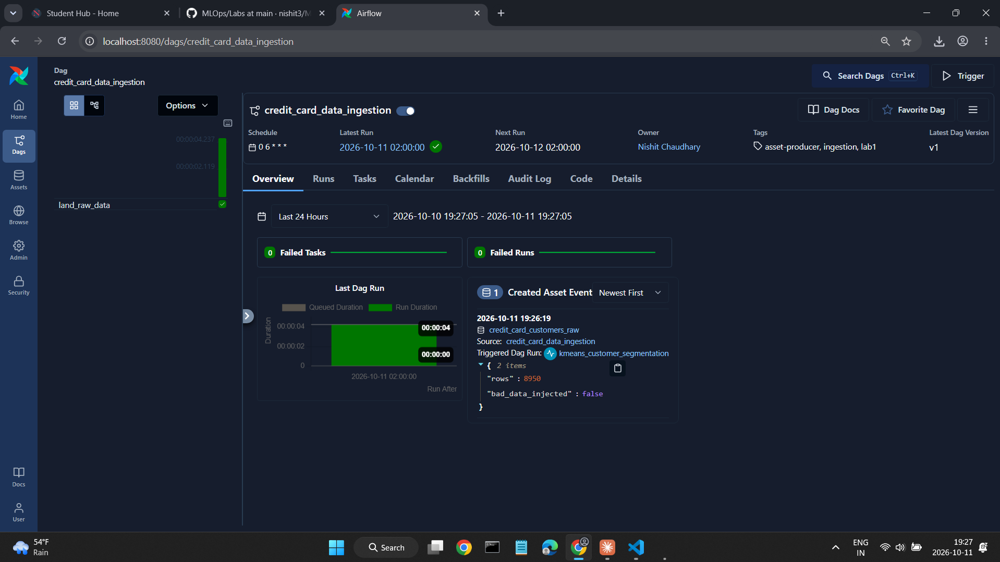

The training run's graph: the branch chose training, `quality_alert` is **skipped** (pink), and `train_kmeans` expanded into **[20] mapped tasks**:

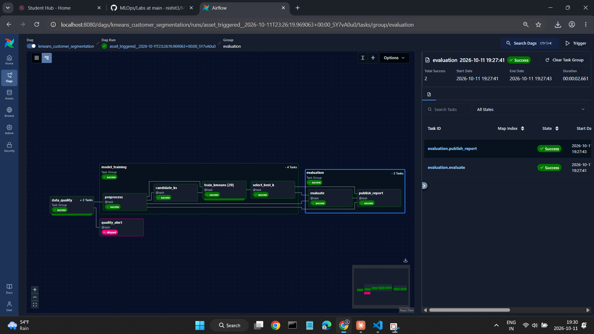

The SSE curve and the chosen k, written to `working_data/latest/elbow_plot.png` by the pipeline:

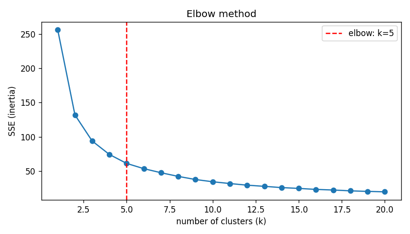

### Demo 2: the quality gate stops bad data

Ingestion triggered with `inject_bad_data` on:

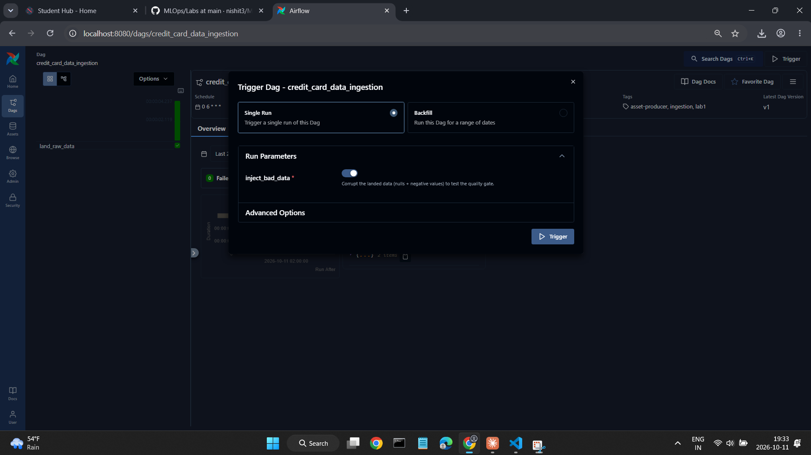

The asset-triggered training run fails at the gate. `data_quality` is green, everything in `model_training` and `evaluation` is **skipped**, and `quality_alert` is **red**:

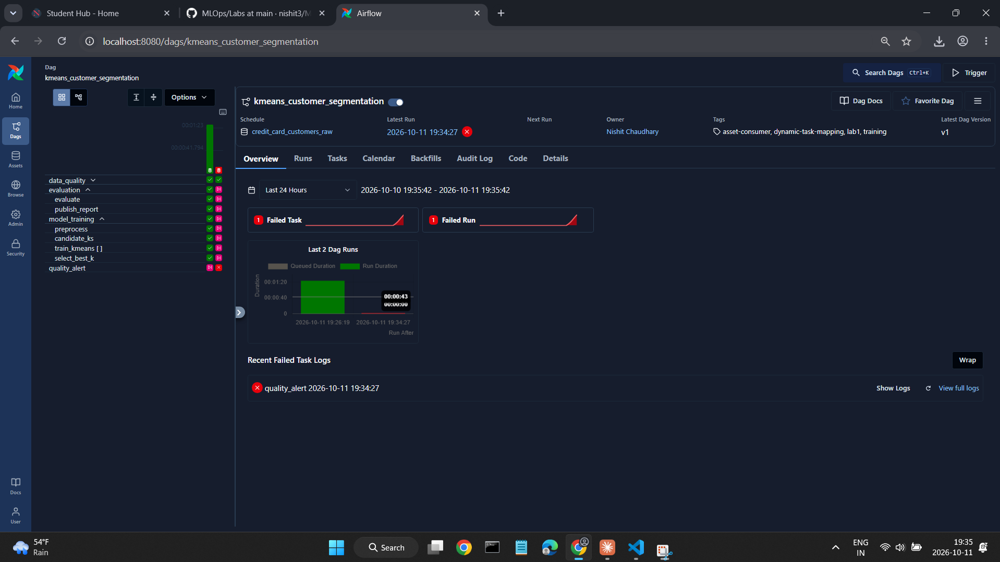

The `quality_alert` log shows the `AirflowFailException` with both failed checks, a single attempt (no retry), and the failure callback's `FAILED quality_alert ...` line:

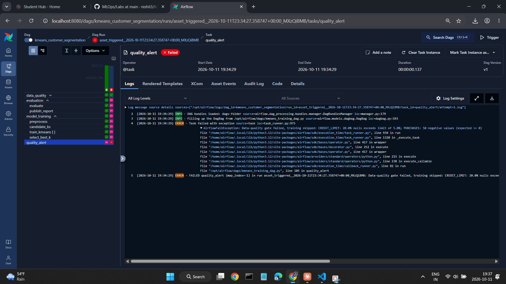

### Demo 3: retries

Manual trigger with `simulate_failure` on. The other params are shown at their defaults in the validated trigger form:

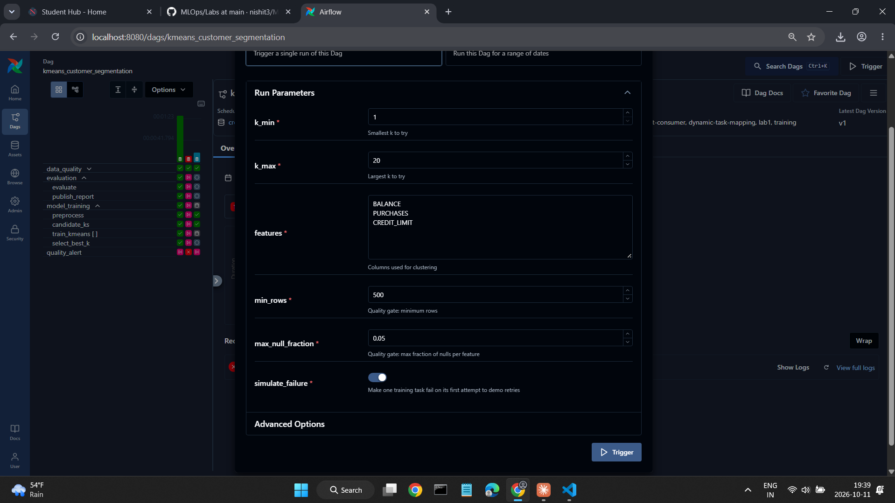

All **20** mapped instances succeeded. **Map index 1 (k = 2) shows Try Number 2**, and every other k shows 1:

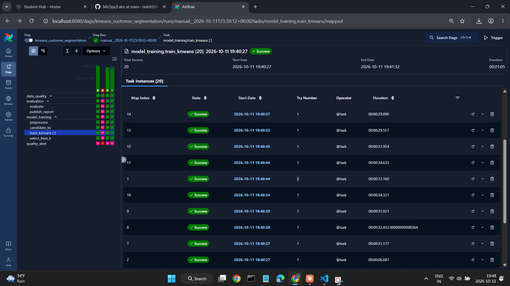

**Attempt 1** of k = 2 fails with `RuntimeError: Simulated transient failure`, and the retry callback logs `RETRYING model_training.train_kmeans (map_index=1) after attempt 1`:

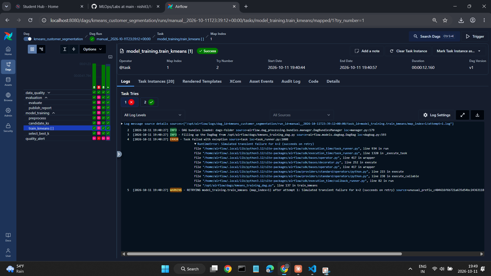

**Attempt 2** succeeds with `k=2 SSE=131.8835`, the same value as the clean run, because training is seeded:

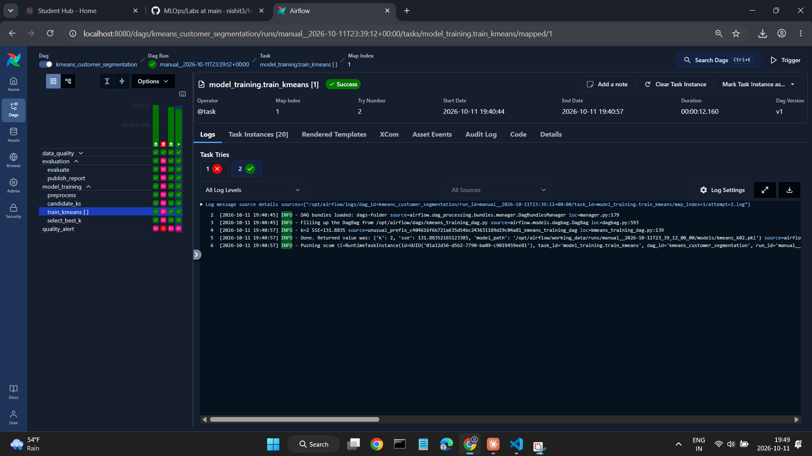

### Tests

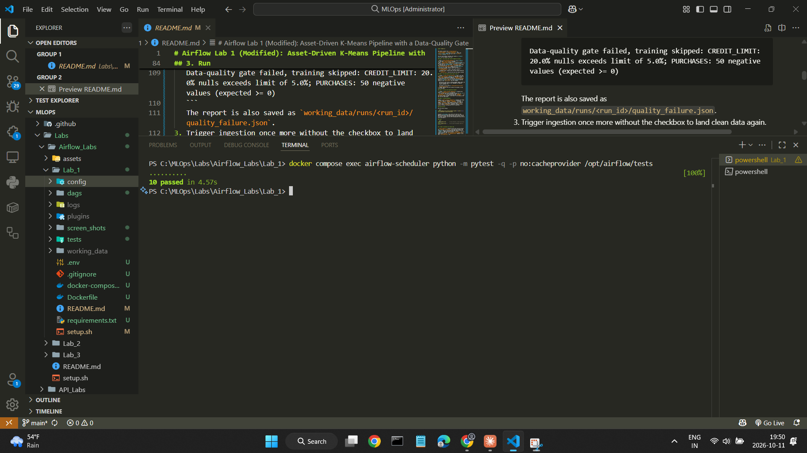

---

## What I changed

### Orchestration changes (the core concept of the lab)

| # | Original lab | This version | What it does / why it matters |
|---|---|---|---|
| 1 | One DAG, triggered manually only (no schedule). | **Two DAGs linked by an Asset.** Ingestion runs on a **cron schedule** (`0 6 * * *`) and declares `outlets=[Asset]`. Training uses `schedule=[Asset]`. | Data-aware scheduling: training runs **when new data arrives**, not at a guessed time. The ingestion task also attaches metadata (row count, bad-data flag) to the Asset event, which is visible in the UI's Assets view. |
| 2 | One task trained K-Means for k = 1…49 in a **sequential loop**. | **Dynamic task mapping:** `train_kmeans.partial(prep=...).expand(k=ks)` creates **one task instance per k at runtime**, run in parallel and capped with `max_active_tis_per_dagrun=8`. A downstream task gathers all mapped results. | The fan-out/fan-in pattern. Each k is retried, logged and timed independently, the work runs in parallel, and the number of tasks follows the `k_min`/`k_max` params with no code change. |
| 3 | A straight 4-task chain with no checks. | A **data-quality gate with branching:** `validate` checks required columns, minimum rows, null fraction and negative values. `@task.branch` then routes to training **or** to `quality_alert`, and Airflow skips the other path. | Bad data never reaches training. The alert task fails the run on purpose (`AirflowFailException`, no retries) so the failure is visible, and it saves the report. Demo 2 shows this. |
| 4 | `retries: 0`. | `retries=2` with **exponential backoff** (`retry_delay` 5s, `max_retry_delay` 1m), an `execution_timeout` of 10 min, and `on_retry_callback` / `on_failure_callback` logging. Config errors and the quality alert use `AirflowFailException` so they fail **without** retrying. | Transient failures heal themselves, hung tasks get killed, and permanent errors fail fast. Demo 3 shows a real retry. |
| 5 | All values hard-coded. | **DAG `Param`s with types and limits** (`k_min`, `k_max`, `features`, `min_rows`, `max_null_fraction`, `simulate_failure`, `inject_bad_data`). They render as a validated form in the Trigger dialog. | The same DAG supports different experiments without editing code, and invalid input is rejected before the run starts. |
| 6 | Whole DataFrames passed through **XCom** as base64-encoded pickles. | Tasks pass only **file paths and small JSON dicts** through XCom. Data and models live in a shared `working_data/` folder, separated **per run** (`runs/<run_id>/`). Files are written atomically (temp file, then rename). | XCom lives in the metadata database and isn't meant for data. Pickled payloads are also unsafe, and Airflow 3 disables XCom pickling. Per-run folders mean runs never overwrite each other. |
| 7 | Classic operator style (`PythonOperator` + `op_args`). | **TaskFlow API** (`@dag`, `@task`, `@task.branch`) from `airflow.sdk`, with **TaskGroups** (`data_quality`, `model_training`, `evaluation`) and `doc_md` shown in the UI. | Dependencies come from the data flow, the code is shorter, and the graph is readable at a glance. |
| 8 | Heavy libraries imported at the top of the DAG file. | `pandas`/`sklearn` are imported **inside tasks**. The DAG files only import Airflow and a small config module. | The DAG processor re-parses DAG files every 30 seconds, so keeping top-level code light is an Airflow best practice. |
| 9 | No tests. | **DAG-integrity tests** (DagBag: no import errors, exact task set, branch targets, retry settings) plus **unit tests** for the pipeline logic, run inside the Airflow container. | Catches a broken DAG before it reaches the scheduler, which is the standard CI check for Airflow projects. |
| 10 | README pointed to the Airflow **2.5.1** compose file, while the DAG code used Airflow **3** imports, so the documented setup didn't match the code. | A pinned **Airflow 3.1.5** stack: `docker-compose.yaml` with the **LocalExecutor** (postgres, api-server, scheduler, dag-processor, triggerer, with healthchecks and a one-time `airflow-init`), and a `Dockerfile` that bakes in the dependencies. | Setup matches the code and works with one set of commands. LocalExecutor drops redis, the Celery worker and flower, which saves memory on a laptop. Dependencies are installed at build time instead of on every container start. |

### Bug fixes in the ML logic

- **The wrong model was saved.** The original saved whichever model was fitted last in the loop (k = 49), not the k the elbow method chose. Now `select_best_k` promotes the chosen k's model to `best_model.pkl`. A test checks that the saved model's `n_clusters` equals `best_k`.
- **Test data wasn't scaled.** The original scaled the training data with `MinMaxScaler` but predicted `test.csv` on raw values, because the scaler was never saved. Now the scaler is saved during preprocessing and applied to the test data. A regression test covers this.
- **Rows were dropped unnecessarily.** The original ran `dropna()` across all 18 columns, discarding rows with missing values in columns the model doesn't use. Now only the selected features are checked.

### Added outputs

The pipeline now reports what the original only printed: a **silhouette score**, **cluster sizes**, the SSE for every k, an **elbow plot**, and a JSON run summary per run.

---

## Project structure

```
Lab_1/
├── dags/
│   ├── data_ingestion_dag.py     # DAG 1: cron-scheduled, produces the Asset
│   ├── kmeans_training_dag.py    # DAG 2: Asset-scheduled, branching + dynamic task mapping
│   ├── data/
│   │   ├── file.csv              # credit-card customer dataset (8,950 rows)
│   │   └── test.csv              # one customer to assign to a cluster
│   └── src/
│       ├── config.py             # paths, the shared Asset, defaults
│       └── lab.py                # pure pipeline logic (no Airflow imports)
├── tests/
│   ├── conftest.py
│   ├── test_lab.py               # unit tests for the pipeline logic
│   └── test_dag_integrity.py     # DagBag / DAG structure tests
├── Dockerfile                    # apache/airflow:3.1.5 + requirements
├── requirements.txt
├── docker-compose.yaml           # LocalExecutor stack
├── .env                          # AIRFLOW_UID and UI login
├── setup.sh                      # one-step setup for Linux/macOS
├── screen_shots/                 # screenshots used in this README
└── working_data/                 # created at runtime: raw/, runs/<run_id>/, latest/
```

## Troubleshooting

- **DAGs don't appear:** wait about 30 seconds for the DAG processor, then refresh. Check `docker compose logs airflow-dag-processor`, or run `docker compose exec airflow-scheduler airflow dags list-import-errors`.
- **The training DAG didn't start after ingestion:** it is probably still paused. Unpause it, then trigger ingestion again.
- **A container keeps restarting or isn't healthy:** give Docker at least 4 GB of memory, then run `docker compose down` and `docker compose up -d`.
- **Port 8080 is already in use:** change `"8080:8080"` under `airflow-apiserver` to `"8081:8080"` and open http://localhost:8081.
- **Linux: permission denied on `logs/` or `working_data/`:** `AIRFLOW_UID` in `.env` doesn't match `id -u`. Fix it, then run `docker compose up airflow-init` again.
