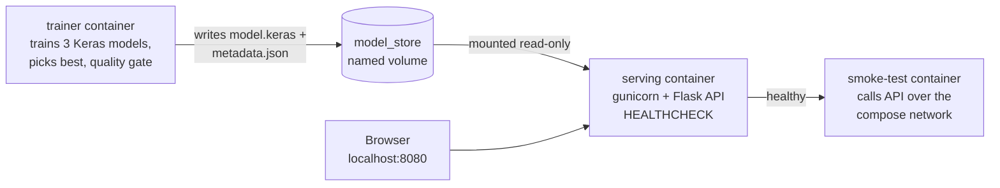

# Docker Lab 2 (Modified): Penguin Species Classifier

This lab trains a **TensorFlow/Keras** neural network in one container, hands the trained model to a second container through a Docker volume, serves predictions from a Flask API behind gunicorn, and verifies the whole pipeline with a third container that tests the API over the Docker network.

It is a modification of the course's Docker Lab 2 (Iris classifier). The main work is in the Docker setup itself: the Dockerfile and `docker-compose.yml` were redesigned, not just pointed at a new dataset. See [Changes made to the lab](#changes-made-to-the-lab).



## Results at a glance

| | |
|---|---|
| Selected architecture | hidden layers `[64, 32, 16]` (best of 3 candidates) |
| Test accuracy | **100%** on 52 held-out penguins (quality gate: 90%) |
| Smoke test | 5/5 checks passed |
| Serving container | `(healthy)`, runs as `appuser`, model volume read-only |
| Image sizes (content) | `penguin-serving` 616 MB, `penguin-trainer` 691 MB |

## What I changed (summary)

**Docker (the core of the lab):**

1. **Made Compose build from the Dockerfile.** The original Compose file ignored the Dockerfile and reinstalled TensorFlow every time the containers started. Now Compose builds tagged images from specific Dockerfile stages, so dependencies are installed once at build time.
2. **Fixed the broken port mapping.** The original exposed port 80, but Flask listened on 4000, so the app was unreachable through Compose. One `PORT` variable now controls gunicorn, `EXPOSE`, the healthcheck, and the port mapping.
3. **Redesigned the multi-stage Dockerfile into 6 stages.** TensorFlow is installed once in a shared base layer used by both images. Requirements are installed before the code is copied, so code edits don't reinstall TensorFlow. Each image only contains what it needs.
4. **Changed how the model moves between containers.** The trainer writes directly into a named volume, and serving mounts it read-only.
5. **Added a quality gate enforced by Compose.** Training fails if test accuracy is below `MIN_ACCURACY`, and `depends_on: service_completed_successfully` then blocks serving from starting with a bad model.
6. **Added a `HEALTHCHECK` and a `/health` endpoint**, so Docker reports whether the API is actually working.
7. **Added a `smoke-test` container** that waits for serving to be healthy, then tests the API over the Compose network and exits 0 or 1.
8. **Moved all configuration into `.env`,** with Dockerfile `ARG` defaults that Compose overrides at runtime.
9. **Hardened the containers:** non-root user, gunicorn instead of Flask's debug server, slim base image, `.dockerignore`, pinned versions, a memory limit, and a restart policy.
10. **Supported two deployment modes from one Dockerfile:** the model on a volume with Compose, or baked into a standalone image with `docker build`.

**Model and dataset (supporting changes):**

- Switched the dataset from Iris to **Palmer Penguins**, which has missing values and categorical features to handle.
- Moved preprocessing **inside the TensorFlow model**. This fixes the original bug where the scaler was used in training but never applied when serving.
- Added **model selection** across three Keras architectures with dropout and early stopping.
- Rebuilt the API and UI to validate input and return **real class probabilities** instead of a hard-coded "CONFIDENCE: HIGH".

Each change is explained in detail, with the original behavior and the reason for the change, in [Changes made to the lab](#changes-made-to-the-lab) below.

---

## 1. Prerequisites

You only need Docker. Python, TensorFlow, and every other dependency are installed inside the images.

| Tool | Version | Notes |
|---|---|---|
| Docker Desktop (Windows/macOS) or Docker Engine (Linux) | Docker Desktop 4.x / Engine 23+ | BuildKit, the default builder in these versions, is required. |
| Docker Compose | v2.20+ | Included with Docker Desktop. Check with `docker compose version`. |
| Git | any | To clone the repo. |

On Windows, use Docker Desktop with the **WSL 2 backend** (the default), and make sure Docker Desktop shows "Engine running" before you continue. Have about 4 GB of free disk space for the TensorFlow images.

Verify your setup:

```bash
docker --version
docker compose version
```

## 2. Get the code and the dataset

```bash
git clone <this-repo-url>
cd <repo>/Labs/Docker_Labs/Lab2
```

The dataset is [Palmer Penguins](https://allisonhorst.github.io/palmerpenguins/): 344 penguins, 3 species, CC0 license. `data/penguins.csv` is committed to this repo. If it's missing, download it:

**Windows (PowerShell):**
```powershell
Invoke-WebRequest -Uri "https://raw.githubusercontent.com/allisonhorst/palmerpenguins/main/inst/extdata/penguins.csv" -OutFile "data/penguins.csv"
```

**macOS / Linux:**
```bash
curl -L -o data/penguins.csv https://raw.githubusercontent.com/allisonhorst/palmerpenguins/main/inst/extdata/penguins.csv
```

## 3. Run it

From the `Lab2` folder:

```bash
docker compose up --build
```

This one command:

1. **Builds two images** from one multi-stage Dockerfile: `penguin-trainer:1.0` and `penguin-serving:1.0`. The first build takes several minutes because of TensorFlow. Later rebuilds after code changes take seconds.
2. **Runs `trainer`.** It trains three candidate network architectures, picks the best on the validation set, checks it against the minimum test accuracy, and writes `model.keras` and `metadata.json` into the shared `model_store` volume. Then it exits.
3. **Starts `serving`** only if the trainer exited successfully. It mounts the volume read-only, loads the model, and serves on **port 8080**.
4. **Starts `smoke-test`** only once `serving` reports healthy. It sends one penguin of each species plus an invalid request to the API and checks the answers.

Then open **http://localhost:8080**, enter measurements, and click **Classify**.

To stop:

```bash
# press Ctrl+C in the terminal running compose, then:
docker compose down        # removes containers, keeps the trained model volume
docker compose down -v     # also deletes the model volume
```

## 4. What a successful run looks like

### Compose output

The run ends with the smoke-test container reporting all checks passed and exiting with code 0:

```
Container penguin-classifier-serving-1 Healthy
smoke-test-1  | [smoke] /health ok, model_version=1.0.0
smoke-test-1  | [smoke] /metadata -> 200, test_accuracy=1.0, selected=[64, 32, 16]
smoke-test-1  | [smoke] PASS: expected Adelie, got Adelie (confidence 1.0)
smoke-test-1  | [smoke] PASS: expected Chinstrap, got Chinstrap (confidence 0.9999)
smoke-test-1  | [smoke] PASS: expected Gentoo, got Gentoo (confidence 1.0)
smoke-test-1  | [smoke] PASS: invalid input rejected with 400: field 'bill_length_mm' must be a number, got 'abc'
smoke-test-1  | [smoke] ALL CHECKS PASSED
smoke-test-1 exited with code 0
```


> **Note:** serving prints a few lines like `Unable to register cuDNN factory` / `cuFFT` / `cuBLAS`. These are harmless TensorFlow messages on machines without a GPU. The model runs on CPU.

### Container health

`serving` stays up and reports `(healthy)` from its Docker `HEALTHCHECK`, with host port 8080 mapped to container port 8000:

```bash
docker compose ps
```


### Web app

The UI shows the predicted species, the model's real confidence, and a probability bar for every class. The footer shows which model version and architecture is being served.


With an unrealistic input (a 111 mm flipper, far below any real penguin), the model is visibly less certain: 73% Chinstrap vs. 27% Adelie. The original lab hard-coded "CONFIDENCE: HIGH" for every prediction, so this uncertainty would have been hidden.


### Model metadata endpoint

`GET /metadata` returns the training results, the scores of every candidate, and the configuration used:

```powershell
Invoke-RestMethod http://localhost:8080/metadata
```


### Image sizes

```bash
docker image ls --filter "reference=penguin-*"
```


| Image | Content size | Disk usage |
|---|---|---|
| `penguin-serving:1.0` | 616 MB | 2.48 GB |
| `penguin-trainer:1.0` | 691 MB | 2.82 GB |

Both images are built on the same `tf_base` stage, so the TensorFlow layers are stored on disk only once and shared between them. The per-image disk usage figures overlap rather than add up. The serving image is smaller because it doesn't contain pandas, scikit-learn, the dataset, or the training code.

### Non-root user and read-only model volume

```bash
docker compose exec serving whoami
docker compose exec serving touch /models/test.txt
```

This prints `appuser`, then `touch: cannot touch '/models/test.txt': Read-only file system`. The container doesn't run as root, and the serving container cannot modify the model it serves.


### Calling the API directly

```powershell
Invoke-RestMethod -Method Post -Uri http://localhost:8080/predict -ContentType "application/json" -Body '{"bill_length_mm":47.5,"bill_depth_mm":15.0,"flipper_length_mm":217,"body_mass_g":5200,"island":"Biscoe","sex":"male"}'
```

This returns the predicted class, its confidence, the probability for every class, and the model version. Re-run the full test suite at any time while serving is up:

```bash
docker compose run --rm --no-deps smoke-test    # exit code 0 = pass
```

## 5. Configuration (no code changes needed)

All settings live in [`.env`](.env), and Compose substitutes them into `docker-compose.yml`.

| Variable | Default | Effect |
|---|---|---|
| `HOST_PORT` | `8080` | Port on your machine. Change it if 8080 is in use. |
| `PORT` | `8000` | Port the API listens on inside the container. |
| `IMAGE_TAG` | `1.0` | Tag applied to both images. |
| `MODEL_VERSION` | `1.0.0` | Recorded in `metadata.json`; shown in the UI and `/health`. |
| `EPOCHS` | `200` | Maximum epochs per candidate (early stopping can end sooner). |
| `MODEL_CANDIDATES` | `16;32,16;64,32,16` | Architectures to compare. `;` separates candidates, `,` separates layer sizes. |
| `DROPOUT` | `0.1` | Dropout after each hidden layer. |
| `MIN_ACCURACY` | `0.90` | Quality gate. Below this test accuracy, the trainer fails and serving never starts. |

These are runtime variables, so changes take effect on the next `docker compose up` without `--build`.

**Try the quality gate:** in `.env`, set `EPOCHS=1` and `MODEL_CANDIDATES=1` (a single 1-neuron layer trained for one epoch), then run `docker compose up`. The weak model falls below the 90% gate, so the trainer prints `QUALITY GATE FAILED` and exits with code 1. Compose then refuses to start `serving`, because its `depends_on` condition `service_completed_successfully` isn't met. Restore the defaults afterwards. (Raising `MIN_ACCURACY` alone won't trigger it, since the default model scores 100%.)

## 6. Standalone image (no Compose)

The same Dockerfile also builds a single self-contained image with the model baked in. Its last stage trains during the build:

```bash
docker build -t penguin-classifier:1.0 .
docker run --rm -p 8080:8000 penguin-classifier:1.0
```

Build-time settings can be passed as build arguments, for example `docker build --build-arg EPOCHS=100 --build-arg MODEL_VERSION=1.1.0 -t penguin-classifier:1.1 .`

So the lab supports two deployment patterns from one Dockerfile:

- **Model baked into the image (standalone):** the image tag *is* the model version. It's immutable and easy to ship or roll back, but retraining means rebuilding the image.
- **Model on a volume (Compose):** the serving image contains no model. Retraining only reruns the trainer, and the same serving image serves whatever passed the quality gate.

---

## Changes made to the lab

### Docker changes (the core concept of the lab)

| # | Original lab | This version | What it does / why it matters |
|---|---|---|---|
| 1 | `docker-compose.yml` ignored the Dockerfile. Both services ran on a bare `python:3.10-slim` image and ran `pip install tensorflow` **every time the containers started**. | Compose builds from specific stages of the Dockerfile (`build.target: model_training` and `serving_runtime`) and tags the images (`penguin-trainer:1.0`, `penguin-serving:1.0`). | Images are built once and run many times, which is the core idea of Docker. Dependencies are installed at build time, not on every start, and the Dockerfile is the single source of truth for the environment. |
| 2 | **Port mismatch:** the Dockerfile exposed port 80 and Compose mapped `80:80`, but Flask listened on port 4000, so the app could not be reached through Compose. | One `PORT` variable drives gunicorn, `EXPOSE`, the healthcheck, and the Compose mapping (`HOST_PORT:PORT`, default `8080:8000`). | The app is reachable, and the port can be changed in `.env` without touching code. |
| 3 | The model was moved with `cp` into a volume by one container and `cp`'d back out by the other. | The trainer writes straight into the `model_store` named volume using a temp file and atomic rename. Serving mounts it **read-only** (`:ro`) and reads it in place through `MODEL_DIR`. | Clear producer/consumer roles: serving can't change the model (proven above), and it can never read a half-written file. |
| 4 | `depends_on` only waited for training to *finish*, whether or not the model was any good. | Training ends with a **quality gate** (`MIN_ACCURACY`) and exits with code 1 if it fails. `service_completed_successfully` therefore blocks a bad model from ever being served. | Compose's dependency rules now enforce a real deployment decision, not just startup order. |
| 5 | No health information. | A `/health` endpoint plus a Dockerfile `HEALTHCHECK` (Python standard library, since slim images have no curl), with a 60-second start period for TensorFlow's slow model load. | `docker compose ps` shows real health, and other services can wait for `service_healthy`. |
| 6 | Nothing checked that the deployment worked. | New **`smoke-test` service**. It waits for serving to be healthy, calls the API over the Compose network by service name (`http://serving:8000`), checks one penguin of each species plus an invalid input, and exits 0 or 1. | One command proves the whole pipeline works end to end. It also demonstrates container-to-container networking via Compose DNS. |
| 7 | One Dockerfile producing one image, with requirements copied together with the code. | **Six-stage Dockerfile:** `base` → `tf_base` → `model_training` / `serving_runtime` → `trained` → `serving`. TensorFlow is installed once in `tf_base` and shared by both images. Requirements are split (`tf.txt`, `train.txt`, `serve.txt`) and installed **before** the source code is copied. | Editing Python code no longer reinstalls TensorFlow (layer caching). Each image only contains what it needs: no Flask in the trainer, and no pandas, scikit-learn, dataset, or training code in serving. One Dockerfile supports both the volume-based and the baked-in deployment. |
| 8 | Configuration was hard-coded in the scripts. | `ARG` defaults in the Dockerfile become `ENV` defaults, which Compose overrides at runtime from `.env`. | Shows the difference between build-time and runtime configuration. You can retrain with different settings without editing code or rebuilding. |
| 9 | Containers ran as root, using Flask's development server with `debug=True`. | Both images run as a non-root `appuser` (UID 10001). The API runs under gunicorn, started with `exec` so it is PID 1 and receives `docker stop` signals. `/models` is created and owned by `appuser` in the image, so a new named volume inherits that ownership. | Production-style container. Debug mode inside a container exposes an interactive debugger, and running as root is unnecessary risk. |
| 10 | Full `python:3.10` base image, no `.dockerignore`, unpinned dependency versions. | `python:3.10-slim`, a `.dockerignore` that keeps `.git`, `.env`, tests, and caches out of the build context, and every dependency pinned. | Smaller images, faster builds, and reproducible results on any machine. |
| 11 | No restart or resource settings. | `restart: unless-stopped` and `mem_limit: 2g` on serving. | Serving recovers from crashes and can't consume all of the host's memory. |

### Model and dataset changes (supporting the Docker work)

- **Dataset: Iris → Palmer Penguins.** Penguins has missing values and categorical features (`island`, `sex`), so training needs a real preprocessing step. Rows without measurements are dropped (344 → 342), and missing `sex` becomes `"unknown"`. The CSV is copied only into the training stages and never appears in the serving image.
- **Preprocessing moved inside the TensorFlow model.** The original standardized features during training but never saved the scaler, so the served model received unscaled inputs. Now Keras `Normalization`, `StringLookup`, and `CategoryEncoding` layers are part of the model. The single `model.keras` artifact accepts raw values, so training and serving can't disagree about preprocessing.
- **Model selection.** The trainer compares several architectures (set in `.env`) using dropout and early stopping, picks the best by validation accuracy (ties broken by lower validation loss), and reports held-out test accuracy. Data is split 70/15/15, stratified by species. Results from the run shown above:

  | Candidate (hidden layers) | Epochs run | Val accuracy | Val loss |
  |---|---|---|---|
  | `[16]` | 200 | 1.00 | 0.0024 |
  | `[32, 16]` | 200 | 1.00 | 0.0004 |
  | **`[64, 32, 16]` (selected)** | 158 (early stopping) | 1.00 | 0.0000 |

  The selected model scored **100% test accuracy** on 52 held-out penguins. Palmer Penguins species are well separated by bill and flipper measurements, so near-perfect accuracy is expected on this dataset.
- **API and UI.** `/predict` accepts JSON or form data and validates every field. Bad input gets a 400 with a clear message, and island and sex must be values seen in training. The response includes real class probabilities and the model version. New `/health` and `/metadata` endpoints were added. The page builds its island and sex dropdowns from the model's metadata, shows a probability bar for each species, shows the model version and test accuracy, and loads no external scripts or fonts.

---

## Project structure

```
Lab2/
├── Dockerfile               # 6 stages: base → tf_base → model_training / serving_runtime → trained → serving
├── docker-compose.yml       # trainer → serving → smoke-test, shared model_store volume
├── .env                     # all runtime configuration
├── .dockerignore
├── requirements/
│   ├── tf.txt               # TensorFlow 2.15.0 + numpy (shared layer)
│   ├── train.txt            # pandas, scikit-learn (training image only)
│   └── serve.txt            # Flask, gunicorn (serving image only)
├── data/
│   └── penguins.csv         # Palmer Penguins dataset (CC0)
├── src/
│   ├── model_training.py    # training, model selection, quality gate
│   ├── main.py              # Flask API: /, /health, /metadata, /predict
│   ├── healthcheck.py       # used by the Dockerfile HEALTHCHECK
│   └── templates/predict.html
├── tests/
│   └── smoke_test.py        # run by the smoke-test service
└── Screen Shots/            # screenshots used in this README
```

## Useful commands for inspecting the Docker side

```bash
docker compose ps                                   # container status and health
docker compose logs trainer                         # training log and candidate scores
docker image ls --filter "reference=penguin-*"      # image sizes
docker history penguin-serving:1.0                  # image layers
docker volume inspect penguin-classifier_model_store
docker compose exec serving ls -l /models           # model files in the read-only mount
```