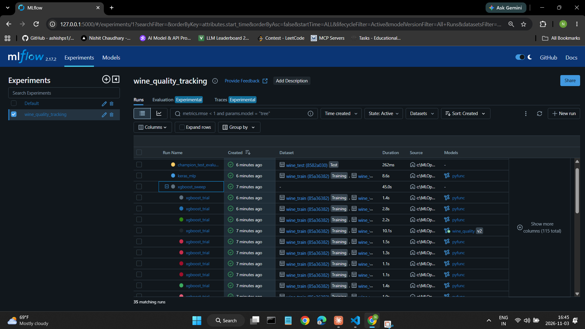

# Experiment Tracking Lab (Modified): MLflow Tracking and Model Registry

A modification of the course's MLflow Lab 2 (wine quality). The prediction task is unchanged: classify a wine as **high quality** (score ≥ 7) from its chemistry. **All my changes are to the lab's core concept, experiment tracking and the model registry**: how runs are organized, evaluated, compared, registered, promoted and served.

Everything runs in **`starter.ipynb`**, committed with the saved outputs of a complete run. Screenshots of the MLflow UI are in [`ss/`](ss).

**Contents:** [1. What I changed](#1-what-i-changed) · [2. Evidence from my run](#2-evidence-from-my-run) · [3. How to run it](#3-how-to-run-it)

---

## 1. What I changed

### Summary: every change, the problem it fixes, and its result

| # | What I changed | Problem in the original | Result from my run |
|---|---|---|---|
| 1 | **Tracking setup:** a named experiment (`wine_quality_tracking`) with a SQLite backend; the MLflow UI runs in its own terminal | Everything went to the "Default" experiment, and `!mlflow ui` inside the notebook blocked the kernel forever | 35 runs organized in one experiment; the notebook runs top to bottom |
| 2 | **Consistent metrics, no test leakage:** every candidate logs the same `val_*` metrics; selection uses validation only; test is used once, at the end | The forest logged **test** AUC and XGBoost logged **validation** AUC under the same name `auc`, and the "best run" was picked by sorting on it | Champion test AUC **0.9061** vs. validation **0.9043**: the selection generalizes |
| 3 | **Richer run metadata:** tags, run descriptions, and the train / validation / test **datasets logged** with every run | No tags, descriptions, or record of the data | Every run lists its datasets in the UI |
| 4 | **XGBoost sweep without Spark:** Hyperopt TPE with local trials as **nested child runs**, per-iteration autologging, and a parent run summarizing the best trial | `SparkTrials` needed pyspark and Java, so it was very hard to run on Windows | 30 nested trials; best val AUC **0.9043** |
| 5 | **Same evaluation for every model:** ROC curve, precision-recall curve and confusion matrix logged as artifacts, plus feature importances | Only a single AUC number was logged | Identical plots and metrics for every candidate |
| 6 | **TensorFlow/Keras model in the comparison**, with `mlflow.tensorflow.autolog()` recording every epoch | Only tree models, no training curves | Per-epoch loss and AUC curves; val AUC **0.8597** |
| 7 | **Leaderboard from code:** `mlflow.search_runs` scoped to this experiment and to tagged candidate runs | `search_runs` searched everything, with no filter | 32 candidates ranked on the same metric |
| 8 | **Registry aliases** (`champion` / `challenger`), with version descriptions and tags | Used `transition_model_version_stage`, which MLflow has **deprecated** | Version 2 is **@champion**; the UI shows "Stage (deprecated): None" |
| 9 | **Promotion gate:** the challenger replaces the champion only if it improves validation AUC by ≥ 0.005; the decision is recorded as tags | The new model was promoted to Production unconditionally | **PROMOTED** XGBoost v2 over the random forest v1 (+0.0317), with an audit trail in the tags |
| 10 | **Batch inference without Spark:** the champion, loaded **by alias**, scores a batch with pandas; predictions and the model version are logged | Needed Spark, and the data-loading line was commented out, so it never ran | 200 wines scored, 14.5% predicted high quality |
| 11 | **Serving by alias**, with a check that the served predictions match the notebook's | Served a stage URI and never checked the response | REST predictions identical to local: **`Match: True`** |

### Details

**Tracking setup (1).** Tracking data goes to a SQLite database (`mlruns/mlflow.db`) instead of plain files, because the model registry and aliases need a database backend. The repo's `.gitignore` already excludes `mlruns/`, so no tracking data is committed.

**One interface for every model (2, 5, 6).** A small `ProbabilityModel` pyfunc wrapper puts the random forest, XGBoost and Keras models behind the same interface, which returns *P(high quality)*. As a result:
- **any family can be registered and promoted,** and
- **loading, batch-scoring and serving code never changes,** whichever model is champion.

Two helpers, `log_evaluation()` and `log_candidate()`, log identical metrics, plots, datasets and tags for every candidate. That's what makes the leaderboard a fair comparison.

**Nested sweep (4).** The parent run `xgboost_sweep` holds 30 child trials, shown grouped under it in the UI. `mlflow.xgboost.autolog()` records each trial's hyperparameters and per-iteration validation AUC. The parent records the search space, the best parameters, the best child's run id, and a sweep-progress chart. The search space was tightened from `max_depth` 4–100 to 4–12, because very deep trees only overfit a dataset this size.

**Registry and promotion gate (8, 9).** The first time the registry is used, the random forest baseline is registered as version 1 and becomes the first `champion`, standing in for "the model currently in production". The leaderboard's best candidate is then registered as `challenger`. It's promoted only if it beats the champion's validation AUC by at least `MIN_IMPROVEMENT` (0.005). Each decision is written onto the model version as tags:
- **`gate_decision`** (promoted or rejected),
- **`gate_compared_with_version`** and **`gate_champion_val_auc`,**
- **`gate_val_auc_improvement`** and **`gate_min_improvement`,** and
- **`status`** (champion, retired or rejected).

Re-running the notebook registers a new challenger, and an identical model is correctly **rejected**.

**Using the champion (10, 11).** Everything downstream loads `models:/wine_quality@champion`: the final test evaluation (the only use of the test set), batch inference, and REST serving. Promoting a new champion changes what consumers get without changing their code.

### Supporting changes (not the focus)

- **Pinned, compatible versions** in `requirements.txt`, replacing the unpinned list, and **pyspark removed**.
- **Removed `_mlflow_conda_env`,** a private MLflow API; models are logged with explicit `pip_requirements` instead.
- **Feature columns cast to `float64`,** so the model signature has one consistent type.
- **The deprecated `sns.distplot` replaced** with `countplot`.
- **Unchanged on purpose:** the wine data, the preprocessing, and the 60 / 20 / 20 split (`random_state=123`).

---

## 2. Evidence from my run

### Runs: nested sweep and logged datasets (changes 1, 3, 4)

The `wine_quality_tracking` experiment holds 35 runs: the baseline, the sweep with its **30 nested trials** (expanded below), the Keras run, and the test-evaluation and batch-inference runs. The *Dataset* column shows the train / validation / test data logged with each run, and the *Models* column shows which trial became registered model **wine_quality v2**.



### Comparing sweep trials (change 4)

MLflow's run comparison relates each trial's hyperparameters to its validation AUC. The weakest of these 5 trials (AUC 0.8826) used the highest learning rate.


### Per-epoch curves from TensorFlow autologging (change 6)

`mlflow.tensorflow.autolog()` recorded training and validation loss and AUC for every epoch. Early stopping ended training at about epoch 40.


### Fair comparison across three model families (changes 2, 5, 7)

All 32 candidate runs logged the same validation metrics. Best run per family:

| Model family | val AUC | val accuracy | val F1 |
|---|---|---|---|
| **XGBoost** (best of 30 trials) | **0.9043** | 0.8868 | 0.6573 |
| Random forest (baseline) | 0.8726 | 0.8722 | 0.6327 |
| Keras network | 0.8597 | 0.8353 | 0.4427 |

The tuned XGBoost model beats the baseline by 3.2 AUC points. The Keras network scores below even the untuned forest, which is typical for small tabular datasets. Its low F1 (0.44) shows it misses most high-quality wines at the default 0.5 threshold. Because every model was measured the same way, this comparison is fair, which it wasn't in the original.

Top 5 trials of the sweep:

| Rank | val AUC | val accuracy | val F1 |
|---|---|---|---|
| 1 | 0.9043 | 0.8868 | 0.6573 |
| 2 | 0.9033 | 0.8799 | 0.6372 |
| 3 | 0.9023 | 0.8822 | 0.6450 |
| 4 | 0.9008 | 0.8768 | 0.6078 |
| 5 | 0.9004 | 0.8814 | 0.6402 |

The forest's logged feature importances agree with the original lab's box plots: **alcohol** (0.160), **density** (0.117) and **volatile acidity** (0.093) are the strongest predictors. The sweep-progress and per-family charts are in the notebook's outputs.

### Registry aliases and the promotion gate (changes 8, 9)

From the notebook:

```
No champion yet: registered the baseline as version 1 and made it champion
Registered challenger: version 2 (xgboost, val_auc 0.9043)
PROMOTED: version 2 (0.9043) replaces version 1 (0.8726), improvement +0.0317
```

In the registry, version 2 carries the **@champion** alias and the full gate record, plus `test_auc` from the final evaluation. Version 1 is marked `retired`:


Version 2's page shows the decision tags (`gate_decision: promoted`, `gate_val_auc_improvement: +0.0317`), and **"Stage (deprecated): None"** beside the alias. The model is managed entirely with aliases, not the deprecated stages:


> **Note:** in the notebook's own registry table, the `aliases` column shows `-`. This is a display limitation of MLflow 2.17: `search_model_versions` doesn't return aliases. The alias is set correctly, as the screenshots show, and everything downstream loads `models:/wine_quality@champion` successfully.

### Final test evaluation of the champion (change 2)

The champion, loaded **by alias**, scored on the held-out test set exactly once:

| Metric | Validation | **Test** |
|---|---|---|
| AUC | 0.9043 | **0.9061** |
| Accuracy | 0.8868 | **0.8823** |
| F1 | 0.6573 | **0.6515** |
| Precision | not logged | 0.7814 |
| Recall | not logged | 0.5586 |

Test AUC matches validation (0.9061 vs. 0.9043), so the model chosen on validation generalizes. That check is only meaningful because the test set played no part in choosing the model.

### Batch inference and serving by alias (changes 10, 11)

**Batch inference:** version 2 scored 200 incoming wines with pandas; 14.5% were predicted high quality. The predictions CSV, the input dataset and the model version are logged in the `batch_inference` run.

**Serving:** `mlflow models serve -m "models:/wine_quality@champion"` served the model as a REST API. The notebook sent 5 wines and compared the responses with the champion loaded locally:

```
Served by REST API: [0.9002 0.0078 0.0044 0.337  0.0005]
Loaded in notebook: [0.9002 0.0078 0.0044 0.337  0.0005]
Match: True
```

---

## 3. How to run it

### Prerequisites

| Tool | Version | Notes |
|---|---|---|
| Python | **3.10 or 3.11** | TensorFlow 2.15 supports 3.9–3.11. Check with `python --version` |
| Disk space | about 2.5 GB | Mostly TensorFlow |
| GPU | not needed | The notebook runs on CPU in a few minutes |

Pinned in [`requirements.txt`](requirements.txt): mlflow 2.17.2, tensorflow 2.15.1, xgboost 2.1.1, scikit-learn 1.5.2, hyperopt 0.2.7, numpy 1.26.4, pandas 2.2.3, matplotlib 3.9.2, seaborn 0.13.2, requests 2.32.3, notebook 7.2.2, ipykernel 6.29.5.

### Setup

From this folder (`Labs/Experiment_Tracking_Labs/Mlflow_Labs/Lab2`):

**Windows (PowerShell):**
```powershell
python -m venv .venv
.venv\Scripts\Activate.ps1
pip install -r requirements.txt
```

**macOS / Linux:**
```bash
python3 -m venv .venv
source .venv/bin/activate
pip install -r requirements.txt
```

The wine data is already in `data/`.

### Run the notebook

With the venv activated, from this folder:

```bash
jupyter notebook starter.ipynb
```

Choose **Kernel → Restart Kernel and Run All Cells**. In VS Code, register the venv as a kernel once with `python -m ipykernel install --user --name mlflow-lab --display-name "Python (mlflow-lab)"`, then pick it under **Select Kernel → Jupyter Kernel...**.

For a clean run with an empty registry, delete the `mlruns/` folder first.

### Open the MLflow UI

In a **second terminal**. Important: run it **from this folder**, because the database path is relative:

```bash
mlflow ui --backend-store-uri sqlite:///mlruns/mlflow.db --port 5000
```

Open **http://127.0.0.1:5000**: the `wine_quality_tracking` experiment is under **Experiments**, and `wine_quality` is under **Models**.

### Serve the champion

In a **third terminal**, also **from this folder**. PowerShell:

```powershell
$env:MLFLOW_TRACKING_URI = "sqlite:///mlruns/mlflow.db"
mlflow models serve -m "models:/wine_quality@champion" --env-manager local --port 5001
```

macOS / Linux:
```bash
MLFLOW_TRACKING_URI=sqlite:///mlruns/mlflow.db mlflow models serve -m "models:/wine_quality@champion" --env-manager local --port 5001
```

When it says it's listening, re-run the notebook's last code cell. It should print `Match: True`.

### What a successful run looks like

- **The setup cell** prints `MLflow: 2.17.2 | TensorFlow: 2.15.1 | XGBoost: 2.1.1 | scikit-learn: 1.5.2` and the experiment id.
- **The leaderboard** lists 32 candidate runs, with XGBoost on top.
- **The registry cell** prints `PROMOTED: ...` on a first run, or `REJECTED: ...` on a re-run with an unchanged model.
- **The champion's test metrics** are printed, and batch inference scores 200 wines.
- **The serving cell** prints `Match: True` once the server is running. Before that, it prints how to start it.
- **The MLflow UI** shows everything in section 2: the nested sweep, the per-epoch Keras charts, and `wine_quality` with **@champion**.

### Troubleshooting

- **`sqlite3.OperationalError: unable to open database file`** (from `mlflow ui` or `mlflow models serve`): the terminal isn't in this folder. `cd` into `Labs/Experiment_Tracking_Labs/Mlflow_Labs/Lab2` and run the command again.
- **`pip` can't find `tensorflow==2.15.1`:** your Python is 3.12 or newer. Use 3.10 or 3.11.
- **The MLflow UI shows no experiments:** same cause as the first item. Also run the notebook at least once, so the database exists.
- **Port 5000 or 5001 is in use:** change the `--port` value. For serving, also update the URL in the notebook's serving cell.

### Files

```
Lab2/
├── starter.ipynb       # the lab, with saved outputs from a full run
├── requirements.txt    # pinned versions
├── data/               # wine quality data (unchanged)
├── ss/                 # MLflow UI screenshots
├── Wine Quality Prediction Lab Documentation.pdf   # the course's original walkthrough
├── README.md
└── mlruns/             # created at runtime: tracking DB + artifacts (not committed)
```
