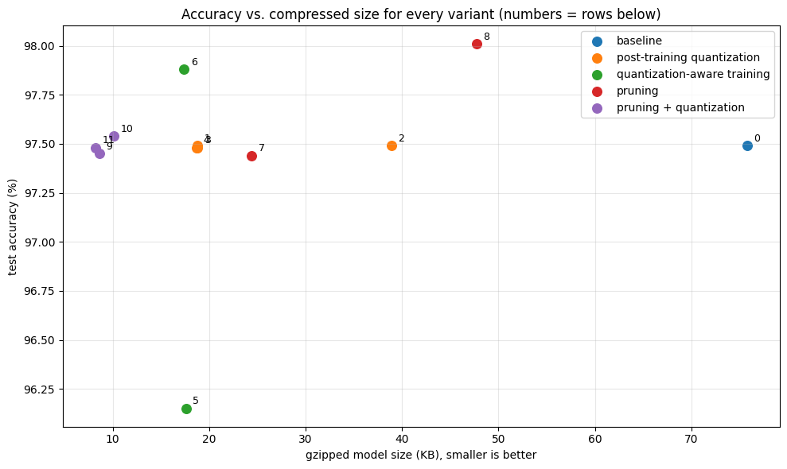
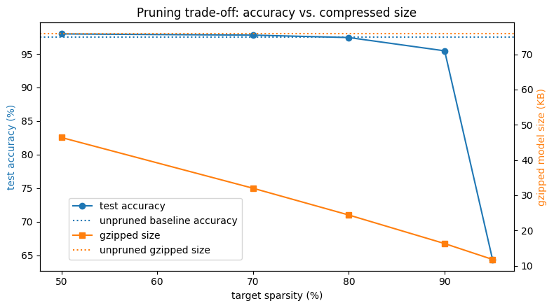

# Model Development Lab (Modified): Quantization and Pruning, Extended

A modification of the course's *Quantization and Pruning* lab (`C3_W2_Lab_3`). The original tried **one variant** of each model-optimization technique. I changed the lab so it **compares the alternatives within quantization and pruning**, fixed its unfair comparisons, and measured every variant the same way. The MNIST dataset and CNN are intentionally unchanged, so every difference comes from the optimization technique itself.

Everything runs in one notebook, **`Quantization_and_Pruning.ipynb`**, committed with the saved outputs of a complete run.

**Contents:** [1. What I changed](#1-what-i-changed) · [2. Results](#2-results-from-my-run) · [3. How to run it](#3-how-to-run-it)

---

## 1. What I changed

### Summary

| # | Change (all in the core topic: quantization and pruning) | Result from my run |
|---|---|---|
| 1 | **Four post-training quantization modes** instead of one: dynamic-range (original), float16, full-integer int8, and integer-only int8 | The integer-only model has **int8 input/output and no float32 tensors**, at −0.01 pp accuracy |
| 2 | **Calibration study** for full-integer quantization (1 / 10 / 100 / 1000 images) | Even 1 image was enough on MNIST (all within 0.04 pp) |
| 3 | **Fair QAT:** fine-tune the trained model instead of training from scratch, compared with PTQ in the same int8 format | **96.15% (original approach) → 97.88%** |
| 4 | **TF Lite evaluator for integer-only models:** quantizes inputs with the model's scale and zero-point | Made rows 3–6 and 9–11 of the results measurable at all |
| 5 | **Pruning sparsity sweep** at 50 / 70 / 80 / 90 / 95% instead of one setting | Accuracy holds to **80%**, drops at 90%, **collapses at 95% (64.4%)** |
| 6 | **Schedule comparison:** `PolynomialDecay` vs. `ConstantSparsity` at 80% | Gradual ramp is **0.25 pp more accurate** |
| 7 | **Structured 2:4 pruning** (hardware-friendly) vs. unstructured | **100%** of groups valid; same accuracy as unstructured 50% |
| 8 | **Measured sparsity** for every model, instead of eyeballing printed weights | Measured sparsity matched every target exactly |
| 9 | **Pruning + quantization pipelines:** prune → PTQ vs. prune → QAT vs. prune → **sparsity-preserving QAT (PQAT)** | Plain QAT lost sparsity (**0.80 → 0.45**); PQAT kept it and gave the **smallest model: 8.2 KB, 9.24× smaller**, accuracy unchanged |
| 10 | **One results table for every variant** (accuracy, size, gzipped size, compression, sparsity, latency) instead of dictionaries reset three times; **latency actually measured** | int8 ran **1.4–1.7× faster** than float32 on my CPU |

### Details: quantization

| # | Original lab | This version | Why it matters |
|---|---|---|---|
| 1 | Only **dynamic-range** quantization (`Optimize.DEFAULT`): int8 weights, but float activations, so the model still needs a float runtime. | **Four post-training quantization modes** on the same trained model, through one `convert_tflite(mode=...)`: dynamic-range, **float16**, **full-integer int8** (int8 activations, calibrated with a representative dataset), and **integer-only int8** (int8 input and output too). A dtype table shows what each file actually contains. | Full-integer and integer-only quantization are what microcontrollers, Edge TPUs and NPUs require, and they're the modes where accuracy can actually suffer. The original never tested them. |
| 2 | No calibration. | **Calibration study:** integer-only conversion with 1, 10, 100 and 1000 calibration images. | Shows how much representative data full-integer quantization needs to estimate activation ranges. |
| 3 | QAT started from **untrained** initial weights for 1 epoch, then was compared against a different quantization format. | QAT from initial weights is kept as a reference, and **QAT fine-tuning from the trained baseline** (lower learning rate) is added, the approach the TensorFlow guide recommends. Both are exported as **integer-only int8** and compared with PTQ in the **same format**. | A like-for-like comparison. The original's QAT result mixed up "less training" with "quantization effects" (96.15% vs. 97.88% here). |
| 4 | The TF Lite evaluator only accepted float inputs, one image at a time. | The evaluator **quantizes inputs with the model's scale and zero-point** and evaluates in batches. | Without this, integer-only models can't be evaluated at all. |

### Details: pruning

| # | Original lab | This version | Why it matters |
|---|---|---|---|
| 5 | One setting: `PolynomialDecay` from 50% to 80%. | **Sparsity sweep** at 50 / 70 / 80 / 90 / 95%, with accuracy, compressed size and compression ratio, plus a trade-off plot. | Shows where pruning stops being free (here, above 80%), which a single setting can't. |
| 6 | One schedule type. | **Schedule comparison:** `PolynomialDecay` (gradual) vs. `ConstantSparsity` (immediate) at 80% with the same training budget. | Shows whether ramping sparsity up gradually helps the network adapt. |
| 7 | Unstructured pruning only. | **Structured 2:4 pruning** (`sparsity_m_by_n=(2, 4)`) on the Dense layer, compared with unstructured 50%, with a check that 100% of weight groups satisfy the 2:4 pattern. | 2:4 is the pattern NVIDIA GPUs accelerate in hardware. Unstructured sparsity mostly helps compression only. |
| 8 | Sparsity was "checked" by printing raw weight tensors. | `weight_sparsity()` **measures** the fraction of zero weights, overall and per layer, for every model. | Turns "you'll see many zeros" into a number. |

### Details: pruning + quantization

| # | Original lab | This version | Why it matters |
|---|---|---|---|
| 9 | Prune, then post-training quantization. | Three pipelines from the same 80%-pruned model: prune → PTQ, prune → ordinary QAT, and prune → **pruning-preserving QAT (PQAT)** via `Default8BitPrunePreserveQuantizeScheme`, each with measured sparsity and compressed size. | Ordinary QAT updates every weight and **undoes much of the sparsity** that pruning created (0.80 → 0.45 here). PQAT keeps it. Shows that the order and method of combining optimizations matter. |

### Details: measurement

| # | Original lab | This version | Why it matters |
|---|---|---|---|
| 10 | Results dictionaries were **reset three times** (`ACCURACY = {}`, `MODEL_SIZE = {}`), mixing raw and compressed sizes. Latency was promised in the introduction but **never measured**. | One `record()` call per variant fills a single table with test accuracy, raw size, gzipped size, compression vs. the float32 TF Lite baseline, measured weight sparsity, and **single-image latency**. An accuracy-vs-size scatter plot covers every variant, and the key findings are computed from the run. | Every technique can finally be compared side by side on the same basis. |

### Supporting changes (needed to run, not the focus)

- **Keras 3 compatibility.** On TensorFlow 2.16+ the original notebook crashes at `quantize_model()`, because TF-MOT doesn't support Keras 3. The first cell now sets `TF_USE_LEGACY_KERAS=1` and imports `tf_keras`, and versions are pinned in `requirements.txt`.
- **A TF 2.17 converter quirk.** When exporting a QAT model as integer-only int8, TF 2.17 wrongly insists on a representative dataset, even though QAT models keep their own learned int8 ranges and don't use one. `convert_tflite()` therefore always sets one (the training images by default). This is also what triggers the harmless "Statistics for quantized inputs" warning.
- **Colab's `private_outputs` flag removed.** It stopped outputs from being saved in the notebook.
- **Fixed random seed** before every training run, so the comparisons are reproducible.
- **The baseline trains for 3 epochs instead of 1,** so it's reasonably converged before being optimized.
- **Model files go to a temporary folder,** not the repo.
- **Unchanged on purpose:** the MNIST dataset and the CNN architecture.

---

## 2. Results from my run

All accuracies are on the 10,000-image MNIST test set. Compression is based on **gzipped** size relative to the float32 TF Lite baseline, because pruning only reduces size once the file is compressed. Latency is the average time for one image on one CPU thread.

### All variants

| # | Variant | Test accuracy | Change (pp) | Size (KB) | Gzipped (KB) | Compression | Weight sparsity | Latency (ms) |
|---|---|---|---|---|---|---|---|---|
| – | Baseline (Keras .h5) | 0.9749 | 0.00 | 96.6 | 76.3 | 0.99× | 0.000 | – |
| 0 | Baseline (float32 TF Lite) | 0.9749 | 0.00 | 82.9 | 75.8 | 1.00× | 0.000 | 0.0103 |
| 1 | PTQ dynamic-range int8 *(original lab)* | 0.9749 | 0.00 | 23.7 | 18.8 | 4.03× | 0.000 | 0.0062 |
| 2 | PTQ float16 | 0.9749 | 0.00 | 43.5 | 38.9 | 1.95× | 0.000 | 0.0105 |
| 3 | PTQ full-integer int8 (float I/O) | 0.9748 | −0.01 | 24.4 | 18.8 | 4.03× | 0.000 | 0.0074 |
| 4 | PTQ integer-only int8 (int8 I/O) | 0.9748 | −0.01 | 24.1 | 18.7 | 4.05× | 0.000 | 0.0074 |
| 5 | QAT from initial weights, 1 epoch *(original lab)* | 0.9615 | −1.34 | 24.2 | 17.6 | 4.31× | 0.000 | 0.0073 |
| 6 | QAT fine-tuned from baseline, 1 epoch | 0.9788 | +0.39 | 24.2 | 17.4 | 4.36× | 0.000 | 0.0076 |
| 7 | Pruned 80% unstructured (float32) | 0.9744 | −0.05 | 82.9 | 24.4 | 3.11× | 0.800 | 0.0101 |
| 8 | Pruned 2:4 structured (float32) | 0.9801 | +0.52 | 82.9 | 47.7 | 1.59× | 0.497 | 0.0105 |
| 9 | Prune 80% → PTQ int8 | 0.9745 | −0.04 | 24.1 | 8.6 | 8.81× | 0.800 | 0.0076 |
| 10 | Prune 80% → QAT int8 | 0.9754 | +0.05 | 24.2 | 10.1 | 7.50× | 0.446 | 0.0076 |
| 11 | **Prune 80% → PQAT int8 (sparsity-preserving)** | 0.9748 | −0.01 | 24.2 | **8.2** | **9.24×** | 0.800 | 0.0074 |

The numbers on the plot below match the `#` column. The `.h5` row isn't plotted, because it's a different file format.



**The best result:** pruning to 80% followed by pruning-preserving QAT gives an integer-only model of **8.2 KB, 9.24× smaller than the float32 baseline**, with accuracy unchanged (97.48% vs. 97.49%).

### Changes 1 and 4: post-training quantization modes

The dtype table from the notebook confirms what each conversion produced:

| Mode | Input / output | Tensors by dtype |
|---|---|---|
| Dynamic-range int8 *(original)* | float32 / float32 | 10 float32, 8 int32, **1 int8** |
| float16 | float32 / float32 | 11 float32, 8 int32, 4 float16 |
| Full-integer int8 | float32 / float32 | 2 float32, 10 int32, 9 int8 |
| Integer-only int8 | **int8 / int8** | **9 int8, 10 int32, no float32** |

The original lab's dynamic-range mode quantizes only the weights and keeps the computation in float32. Only the integer-only model has no float tensors at all, which is what integer-only hardware requires. On this simple task every mode kept accuracy within 0.01 points.

### Change 2: calibration

| Calibration images | Test accuracy | Change vs. float32 (pp) |
|---|---|---|
| 1 | 0.9745 | −0.04 |
| 10 | 0.9746 | −0.03 |
| 100 | 0.9748 | −0.01 |
| 1000 | 0.9746 | −0.03 |

For this small MNIST model, even a single calibration image is enough: activation ranges are easy to estimate because MNIST inputs are consistent. The differences are within run-to-run noise. On more varied data, calibration size matters more.

### Change 3: quantization-aware training

| Variant (all integer-only int8) | Test accuracy |
|---|---|
| Float32 baseline (reference) | 0.9749 |
| PTQ integer-only int8 | 0.9748 |
| QAT from initial weights *(original lab's approach)* | **0.9615** |
| QAT fine-tuned from the trained baseline | **0.9788** |

The original lab's QAT setup scored **1.3 points below** the baseline, but that came from training an untrained model for a single epoch, not from quantization itself. Fine-tuning the trained model instead gives the **best int8 accuracy**. It even edges past the float32 baseline, because fine-tuning adds one more epoch of training.

### Changes 5 and 8: pruning sparsity sweep

| Target sparsity | Measured sparsity | Test accuracy | Gzipped (KB) | Compression |
|---|---|---|---|---|
| 50% | 0.50 | 0.9798 | 46.4 | 1.63× |
| 70% | 0.70 | 0.9780 | 32.0 | 2.37× |
| 80% | 0.80 | 0.9744 | 24.4 | 3.11× |
| 90% | 0.90 | 0.9546 | 16.3 | 4.65× |
| 95% | 0.95 | **0.6439** | 11.8 | 6.42× |



Measured sparsity matches every target exactly. Accuracy holds up to **80% sparsity** (−0.05 points), slips at 90% (−2.0 points), and **collapses at 95%** (64.4%). That makes 80% the sweet spot for this model, which is why changes 6 and 9 use it.

### Change 6: pruning schedule

| Schedule (80% target) | Measured sparsity | Test accuracy | Gzipped (KB) |
|---|---|---|---|
| PolynomialDecay 0% → 80% | 0.80 | **0.9744** | 24.4 |
| ConstantSparsity 80% | 0.80 | 0.9719 | 24.5 |

Ramping sparsity up gradually gives the network time to adapt, and it ends 0.25 points more accurate at the same sparsity and size.

### Change 7: structured 2:4 vs. unstructured pruning

| Pruning | Measured sparsity | Test accuracy | Gzipped (KB) |
|---|---|---|---|
| Unstructured 50% | 0.500 | 0.9798 | 46.4 |
| Structured 2:4 (Dense layer) | 0.497 | 0.9801 | 47.7 |

**100.0%** of weight groups in the Dense layer satisfy the 2:4 pattern. The structured version matches unstructured accuracy at the same sparsity and compresses almost as well (47.7 vs. 46.4 KB), while being the pattern that NVIDIA GPUs can accelerate in hardware. Its sparsity is 0.497 rather than 0.500 because the small conv layer is left unpruned.

### Change 9: pruning + quantization

| Pipeline (from the same 80%-pruned model) | Weight sparsity | Gzipped (KB) | Test accuracy |
|---|---|---|---|
| Prune → PTQ int8 | 0.800 | 8.6 | 0.9745 |
| Prune → ordinary QAT int8 | **0.446** | 10.1 | 0.9754 |
| Prune → **PQAT** int8 | **0.800** | **8.2** | 0.9748 |

Ordinary QAT updates every weight, so after just one epoch almost **half the pruned weights were non-zero again** (sparsity fell from 0.80 to 0.45) and the compressed file grew by 23%. PQAT kept all of the sparsity and gave the smallest model of the whole lab. The order and method of combining optimizations matter.

### Change 10: latency

On this machine (one CPU thread), the int8 models ran **1.4–1.7× faster** per image than float32 (0.0062–0.0076 ms vs. 0.0103 ms). float16 gave no speedup (0.0105 ms), as expected: CPUs convert float16 weights back to float32 to compute. Pruning alone didn't change latency (0.0101 ms), because zero weights are still multiplied unless the hardware supports sparse kernels. These timings are specific to this CPU; on edge hardware with integer or sparse accelerators the differences are typically larger.

---

## 3. How to run it

### Prerequisites

| Tool | Version | Notes |
|---|---|---|
| Python | **3.10–3.12** (this run used 3.10) | Check with `python --version`. TensorFlow 2.17 doesn't support 3.13 |
| pip | any recent | Comes with Python |
| Disk space | about 2 GB | Mostly TensorFlow |
| GPU | not needed | The whole notebook runs on CPU in about 5–10 minutes |

Library versions are pinned in [`requirements.txt`](requirements.txt). They must match each other: the TensorFlow Model Optimization Toolkit (`tfmot`) supports **Keras 2 only**, while TensorFlow 2.16+ defaults to Keras 3. So the lab uses `tf-keras` (Keras 2) at the same version as TensorFlow:

| Package | Version |
|---|---|
| tensorflow | 2.17.1 |
| tf-keras | 2.17.0 |
| tensorflow-model-optimization | 0.8.0 |
| numpy / pandas / matplotlib | 1.26.4 / 2.2.3 / 3.9.2 |
| notebook / ipykernel | 7.2.2 / 6.29.5 |

### Setup

From this folder (`Labs/Model_Development/Quantization_and_Pruning`), create a virtual environment and install the dependencies.

**Windows (PowerShell):**
```powershell
python -m venv .venv
.venv\Scripts\Activate.ps1
pip install -r requirements.txt
```
If PowerShell blocks the activate script, run `Set-ExecutionPolicy -Scope CurrentUser RemoteSigned` once, then try again.

**macOS / Linux:**
```bash
python3 -m venv .venv
source .venv/bin/activate
pip install -r requirements.txt
```

**Google Colab (no local install):** upload the notebook, uncomment the `!pip install ...` line at the top of the first code cell, run it once, choose **Runtime → Restart session**, then continue with the next step.

### Run

With the virtual environment activated:

```bash
jupyter notebook Quantization_and_Pruning.ipynb
```

In the browser tab that opens, choose **Kernel → Restart Kernel and Run All Cells**.

To use VS Code instead, register the environment as a Jupyter kernel once (with the venv activated), then pick it from **Select Kernel → Jupyter Kernel...** in the notebook:

```bash
python -m ipykernel install --user --name quant-prune-lab --display-name "Python (quant-prune-lab)"
```

Always run from the top. The first cell switches TensorFlow to Keras 2, which only works before TensorFlow is imported. Trained model files are written to a temporary folder (its path is printed in the first cell), not into the repo.

### What a successful run looks like

- **First cell** prints `TensorFlow: 2.17.1`, `Keras: 2.17.0` and `TF-MOT: 0.8.0`, with no assertion error.
- **Every cell finishes without errors.** Each training run prints its epochs, and every variant prints one line of measurements when it's recorded.
- **A1** shows a dtype table in which the integer-only model has `int8` input and output and no float32 tensors at all.
- **B1** shows the sparsity-sweep table, where measured sparsity matches each target, plus the accuracy-vs-size plot.
- **B3** prints `2:4 pattern satisfied by 100.0% of groups in the Dense kernel`.
- **C** shows that ordinary QAT loses much of the pruning sparsity, while PQAT keeps it at 0.80.
- **D** shows the final results table, the accuracy-vs-size scatter plot, and a printed list of key findings.

Several cells print `UserWarning: Statistics for quantized inputs were expected, but not specified; continuing anyway.` This is harmless; see the TF 2.17 note under [Supporting changes](#supporting-changes-needed-to-run-not-the-focus).

### Files

```
Quantization_and_Pruning/
├── Quantization_and_Pruning.ipynb   # the lab, with saved outputs from a full run
├── requirements.txt                 # pinned versions
├── screen_shots/                    # the two plots, exported from the notebook outputs
│   ├── accuracy_vs_size.png
│   └── sparsity_sweep.png
└── README.md
```

### Troubleshooting

- **`AssertionError: Keras 3 detected`:** `tf-keras` isn't installed in the active environment, or the kernel isn't your `.venv`. Run `pip install -r requirements.txt` inside the venv, select it as the kernel, and restart.
- **`ValueError: ... to_annotate can only be a keras.Model` or similar at `quantize_model`:** the same Keras 3 problem. Restart the kernel and run from the first cell.
- **`ValueError: For full integer quantization, a representative_dataset must be specified`:** you're running an older copy of the notebook. The current `convert_tflite()` always sets one.
- **VS Code doesn't list the `.venv` kernel:** register it with the `ipykernel install` command above, or run `jupyter notebook` from the activated venv instead.
- **`pip` can't find `tensorflow==2.17.1`:** your Python is outside 3.9–3.12. Use 3.10, 3.11 or 3.12.
- **The notebook is slow:** the sparsity sweep trains 5 models. It should take a few minutes on a laptop CPU; nothing needs a GPU.
